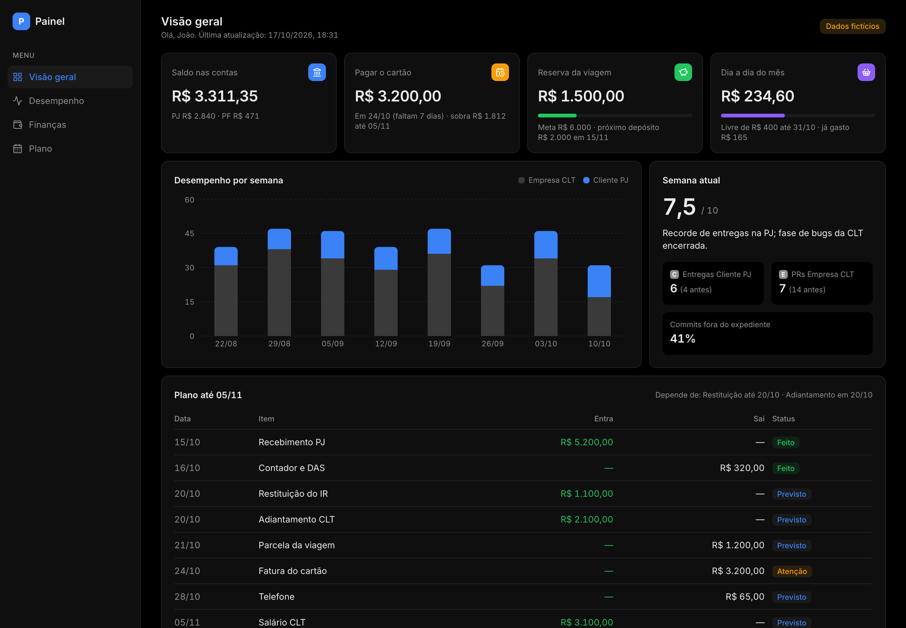
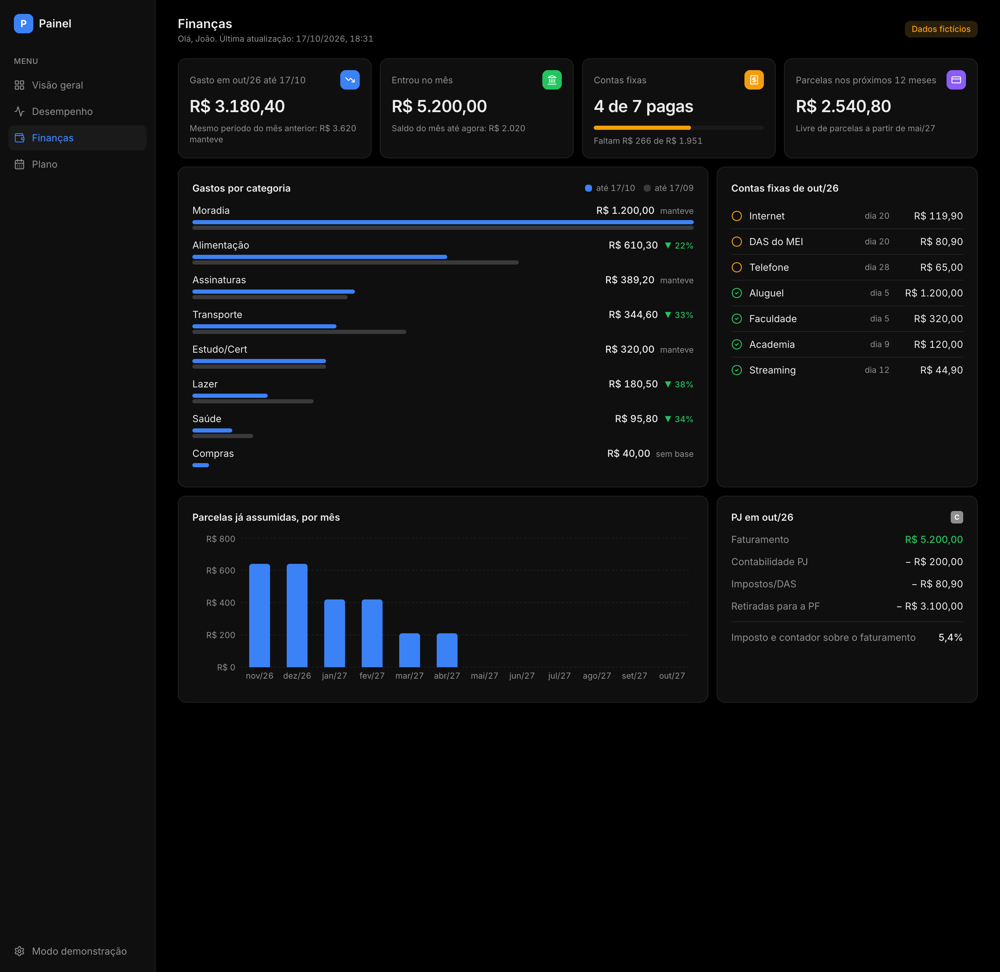
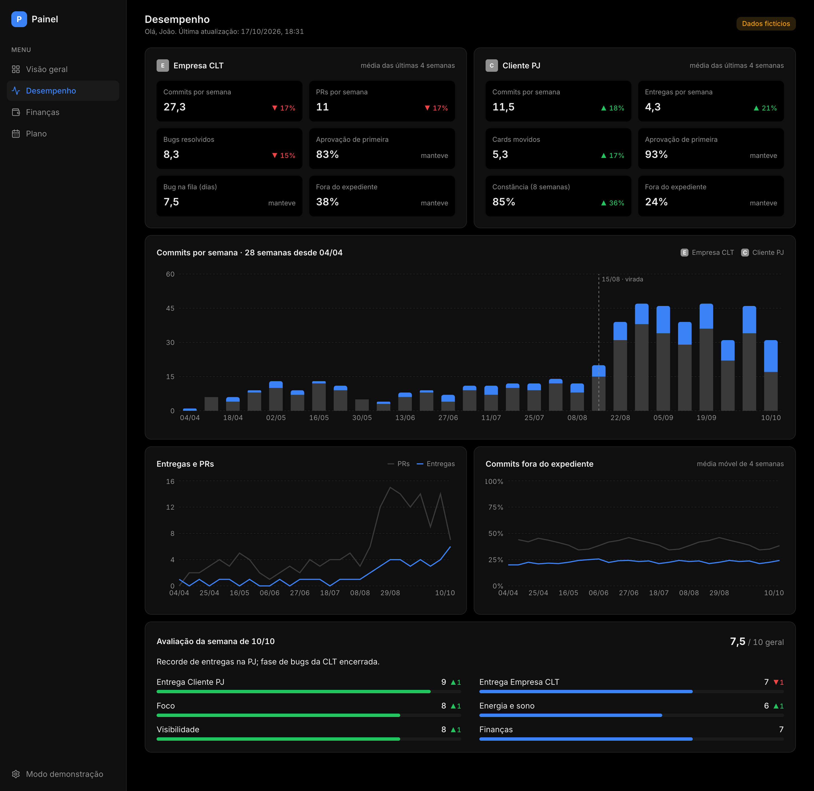
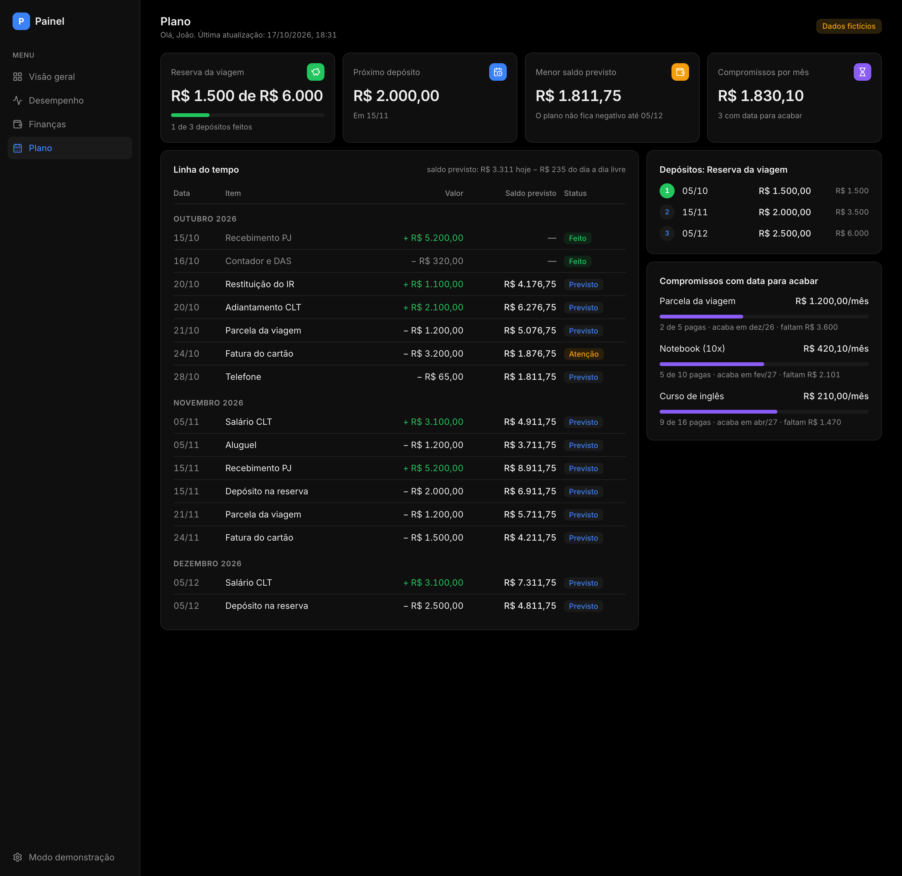

# Painel pessoal

Finanças e desempenho como dev numa tela só, para abrir de qualquer lugar.
Next.js 15 (App Router), Tailwind 4 e Recharts. Tema claro e escuro, layout de celular.



| Tela | O que mostra |
|---|---|
| Visão geral | saldo, próximo marco do plano, meta, dia a dia do mês, semana atual e plano do mês |
| Finanças | gasto do mês contra os mesmos dias do mês anterior, por categoria; contas fixas pagas e pendentes; parcelas dos próximos 12 meses; faturamento e custos da PJ |
| Plano | linha do tempo com saldo previsto item a item (já descontado o dia a dia livre), depósitos da meta e compromissos com data para acabar |
| Desempenho | média de 4 semanas por empresa (com variação), histórico de commits com marcos, entregas e PRs, % fora do expediente (média móvel) e a avaliação da semana por área |







## Dois modos, um código

| Modo | Dados | Acesso |
|---|---|---|
| `demo` (padrão) | `src/data/demo.json`, fictício | público |
| `privado` | `painel.json` gerado depois de cada sync | senha (HTTP Basic) |

No modo privado o JSON é lido **só no servidor** e nunca vai para o navegador como arquivo.
Ele tem apenas totais: saldo por conta, o plano do mês, o gasto do dia a dia e contagens por semana.
Nenhum lançamento, nenhuma contraparte, nenhuma credencial.

## De onde vêm os números

- **Finanças:** [financas-open-finance](https://github.com/themacedo/financas-open-finance) sincroniza as contas
  pelo Open Finance (Pluggy) e, no fim do sync, gera o `painel.json` a partir do ledger e de um `plano.yaml`
  (o plano do mês: entradas, saídas, o próximo marco e a meta).
- **Desempenho:** a revisão semanal (commits, PRs, entregas e % fora do expediente) e a nota da avaliação.

O contrato está em [`src/lib/tipos.ts`](src/lib/tipos.ts). Nomes, cores e logos das empresas vêm do próprio
JSON (`empresas`), então o código não conhece nenhum cliente.

## Rodar

```bash
pnpm install
pnpm dev            # modo demo em http://localhost:3000
```

Modo privado local:

```bash
PAINEL_MODO=privado PAINEL_SENHA=uma-senha PAINEL_DADOS_ARQUIVO=/caminho/painel.json pnpm dev
```

Em produção (Vercel), em vez do arquivo:

| Variável | Valor |
|---|---|
| `PAINEL_MODO` | `privado` |
| `PAINEL_SENHA` | a senha da página |
| `PAINEL_DADOS_URL` | `https://api.github.com/repos/<você>/<repo-privado>/contents/painel.json` |
| `PAINEL_DADOS_TOKEN` | token *fine-grained* só com leitura de conteúdo desse repositório |

Sem `PAINEL_SENHA`, o modo privado nega todo acesso.
